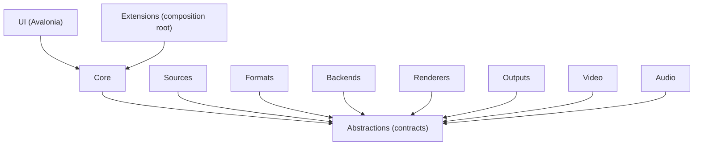
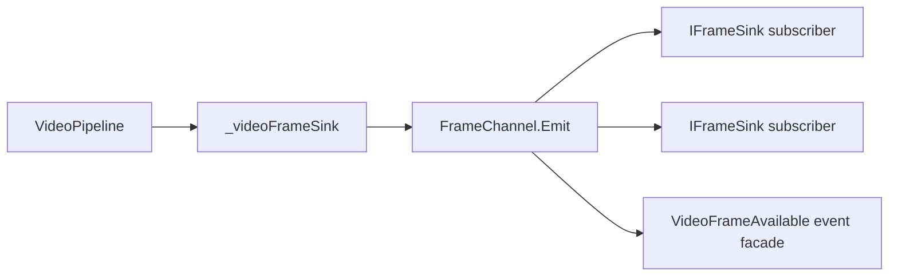

# Architecture

LingFan.Media is a layered, contract-driven system. The contract layer is the
"law" every other layer depends on; the core orchestrates playback without
knowing any concrete backend or UI; backends, renderers and outputs plug in
through dependency injection.

## Module map

| Module | Responsibility |
|---|---|
| Abstractions | Pure contracts: interfaces, models, enums, events. Zero implementation, zero external references. |
| Core | Playback orchestration: clock, buffering, frame routing, pipeline host, session lifetime. Knows no backend or UI. |
| Sources | Media origins: file, network (HTTP/HTTPS), wrapped streams; stream factory and SSRF guard. |
| Formats | Container parsing and demuxing helpers, format detection. |
| Video | Video track model, processing chain and configuration. |
| Audio | Audio track model, mixing, effects and configuration. |
| Backends | Pluggable decoding/demuxing: FFmpeg, LibVLC, Media Foundation, MediaCodec, AVFoundation. |
| Renderers | GPU video output: D3D11, Vulkan, OpenGL, OpenGL ES, Metal. |
| Outputs | Audio output: WASAPI, OpenAL, OpenSL ES, AAudio, AVAudioEngine. |
| Platforms | Platform services and native interop helpers. |
| Extensions | DI composition root: `AddLingFanMedia()` and the module registration extensions. |
| UI (Avalonia) | Optional presentation layer: `VideoView`, presenters, controls. Depends on Core, never the reverse. |

## Dependency direction

Dependencies point one way, toward the contracts:

- `Abstractions` references nothing but the BCL and logging abstractions.
- `Core` references `Abstractions` only — it never references a backend, renderer
  or UI framework.
- Backends, renderers and outputs reference `Abstractions` (and GPU glue layers),
  not each other and not the UI.
- A type referenced by two or more layers lives in `Abstractions`; a type used by
  a single module stays inside that module.

## Frame routing

Video frames flow through a single channel. There is no second, divergent
delivery path for headless versus UI consumers.

- `IFrameChannel` is the port: `Subscribe(IFrameSink)`, `Unsubscribe(IFrameSink)`,
  `Emit(VideoFrame)`. `IFrameSink.OnFrame(VideoFrame)` receives a **read-only
  borrow** — a sink must not dispose the frame or hold a reference after the call
  returns (with multicast subscribers, doing so causes use-after-free).
- The public `IMediaPlayer.VideoFrameAvailable` event is an `Action<VideoFrame>`
  adapter over this same channel. Advanced consumers (recording, thumbnails,
  inference) can implement `IFrameSink` and subscribe directly.
- The headless consumer helpers (`ProcessingFrameSink`, `ProcessingAudioSink`)
  implement `IHeadlessFrameConsumer` / `IHeadlessAudioConsumer` and attach to the
  pipeline; the UI `VideoView` subscribes to the channel and presents frames.

## Unified ports (and one intentional asymmetry)

- **Video** is routed through `IFrameChannel` / `IFrameSink`, so any number of
  consumers can observe the same decoded frames.
- **Audio** is submitted directly to `IAudioOutput.Submit`, bypassing the video
  synchronizer. This asymmetry is intentional: audio is the timing master and is
  pushed to the device on its own clock, while video is paced against that clock.

## Headless-first

`IVideoRenderer.Present` is driven by the same frame channel a headless consumer
uses. In a UI, `VideoView` subscribes to the channel and presents through the
platform compositor (DirectComposition, CAMetalLayer, SurfaceFlinger, Wayland
subsurface). The core never creates a native window of its own — rendering is
always composed into the host's surface, so UI controls can freely overlay video.

## Session isolation and DI lifetimes

- System-level factories (stream factory, decoder/renderer/output factories,
  codec registry) are **singletons** registered once in the composition root.
- Each `IMediaPlayer` owns an independent **session** (`IMediaSession`): its own
  `IMediaClock`, `IBufferManager` and pipelines. Session objects are created
  inside `OpenAsync`, not in the constructor, so a player can be constructed
  cheaply and opened later.
- This keeps concurrent players fully isolated — no shared clock, buffer or
  pipeline state between sessions.
