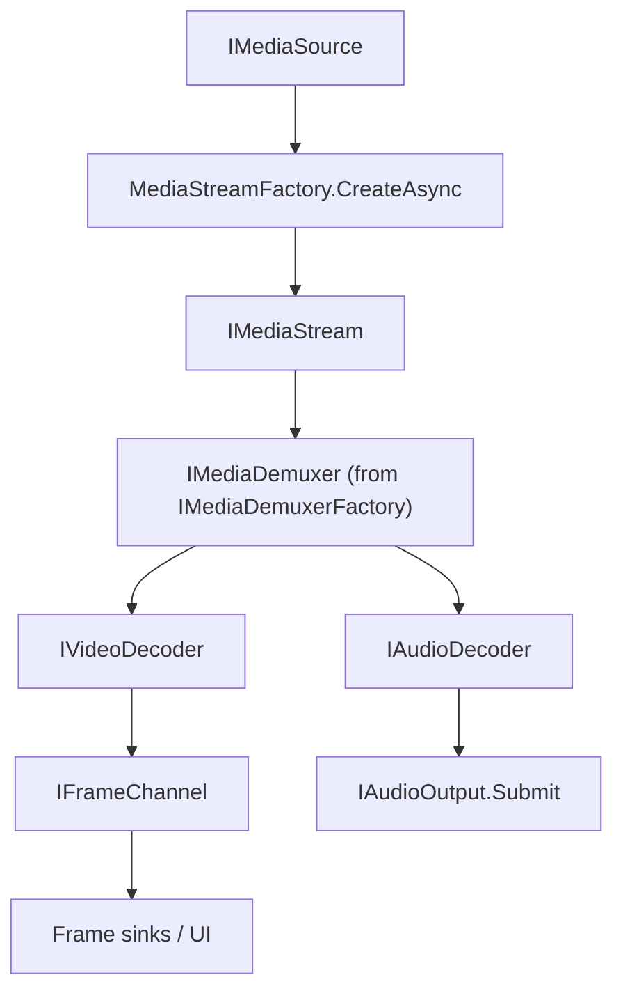
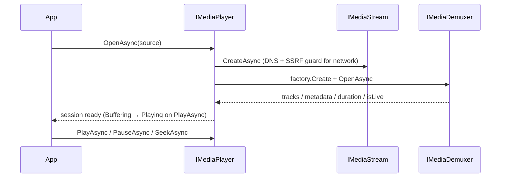

# Backends

A backend supplies demuxing and decoding behind the shared contracts. Backends
are interchangeable: registering a different one changes a single DI line, and
the core, renderers and outputs are unaffected. For the authoritative
platform-by-platform availability matrix, see [Platform Support](/guide/platforms).

## Backend architecture

Demuxer factories are registered as an ordered collection (via each backend's
`AddXxx()`), so the player can try them in sequence and fall back. If no
registered backend can open a source, `Create`/`Open` surfaces
`MediaBackendUnsupportedException` rather than failing silently.

## Cross-platform backends

| Backend | License | Role | Platforms |
|---|---|---|---|
| FFmpeg | LGPL 2.1+ (shared build) | Primary decoding/demuxing | Windows, Linux, Android, macOS, iOS |
| LibVLC | LGPL 2.1+ | Fallback engine | Windows, Linux (other platforms as supported) |

Both are loaded dynamically at runtime; neither is statically linked. See
[Licensing](/guide/licensing) for the compliance model.

## GPU zero-copy by backend

| Backend | Zero-copy | Path |
|---|---|---|
| FFmpeg | Yes | Windows: D3D11VA / DXVA2 → D3D11 (and Vulkan/OpenGL import). Linux: VAAPI → dma-buf → Vulkan (OpenGL falls back to CPU upload where the driver's import surface is limited). |
| MediaCodec | Yes | Android: Surface output → AHardwareBuffer → GLES/EGL bridge → Skia GPU sampling on the same device; a ByteBuffer CPU path is retained as a cross-vendor fallback. |
| Media Foundation | No | The MFT pipeline does not expose an importable shared texture for this path; frames are returned through CPU memory (a inherent property of the pipeline, not a defect). |
| LibVLC | No | The 3.x callback API delivers CPU pixels, so this path uses CPU copies. True zero-copy would require libvlc 4.0, which is not adopted. |

"Zero-copy" here means the decoded frame stays as a GPU resource (`IFrameResource`)
from decoder to renderer without a CPU round-trip. Where a platform or driver
cannot import the surface, the renderer falls back to a correct CPU upload — the
picture is still correct, only the copy path differs.

## Platform-native backends

| Platform | Native backend | Status |
|---|---|---|
| Windows | Media Foundation | Available |
| Android | MediaCodec | Available (validated on device) |
| Apple (macOS / iOS) | AVFoundation | Partial; not yet fully validated |
| Linux | None native | Uses FFmpeg with VAAPI hardware decode |

## Not implemented

| Backend | State |
|---|---|
| GStreamer | Empty scaffold; no implementation. Not on the roadmap. |
| WebRTC | Stub that throws `PlatformNotSupportedException`. Not on the roadmap. |

## From open to ready

`OpenAsync` performs the real I/O (stream creation, demuxer open, initial
buffering). `PlayAsync` / `PauseAsync` are in-memory state transitions.
`SeekAsync` re-positions through the stream (range re-open for network sources).
