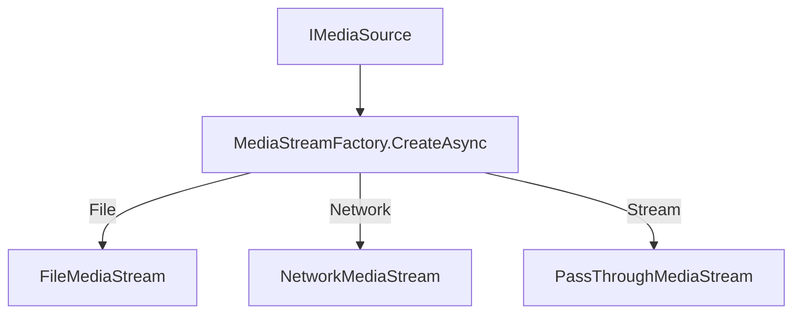

# Media Sources

A media source describes where media comes from. The stream factory turns a
source into an `IMediaStream` the demuxer can read. Three source kinds are
supported.

## Source types

| Source | Kind | Stream produced | Notes |
|---|---|---|---|
| `FileMediaSource` | File | `FileMediaStream` | Local file; the primary path for file playback. |
| `NetworkMediaSource` | Network (HTTP/HTTPS) | `NetworkMediaStream` | SSRF-guarded; supports range-based seeking, custom headers, cookies and read timeouts. |
| `StreamMediaSource` | Stream | `PassThroughMediaStream` | Wraps a caller-supplied `System.IO.Stream`. |

The factory pattern-matches on `IMediaSource.Type` (`MediaSourceType`) and
constructs the matching stream.

## Implementation notes

- **Network SSRF protection.** `NetworkMediaSource` rejects non-HTTP(S) schemes
  such as `file://` and, by default, private / loopback / link-local addresses.
  DNS is resolved before the guard check and the resolved IP is pinned for the
  connection, closing the re-resolution window that a redirect could otherwise
  exploit to reach an internal address.
- **Range-based seeking.** Network seeking re-opens the connection with an HTTP
  `Range` request rather than seeking a socket. A server that ignores `Range`
  (replying `200` instead of `206`) is detected and rejected, so a non-seekable
  stream is never silently treated as seekable.
- **Open headers.** User-agent, custom headers and cookies are gathered on the
  stream contract so address-based backends can pass them through.
- **Stream sources.** `StreamMediaSource` wraps a caller-owned stream; thread
  safety and lifetime of that stream are the caller's responsibility.
- **Live flag.** `IsLive` is derived from the source kind (network sources are
  treated as potentially live); seeking on a non-seekable source depends on the
  underlying stream's capabilities.

See [Backends](/guide/backends) for how a opened stream is handed to a demuxer,
and the [API Reference](/api/) for `IMediaSource` / `IMediaStream` exact signatures.
