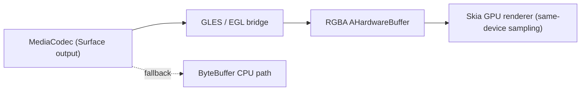

# Platform Support

This page is the **single source of truth** for what is supported on each
platform. Other pages link here rather than duplicating the matrix, so support
status is stated once and stays consistent.

Status legend: **Validated** = exercised end-to-end on real hardware;
**Implemented** = code complete, validation pending; **Partial** = some
components present, not yet complete; **Not available** = no implementation.

## Support matrix

| Platform | Overall | Decoding backends | GPU renderers | Audio outputs | GPU zero-copy |
|---|---|---|---|---|---|
| Windows | Validated | Media Foundation, FFmpeg, LibVLC | D3D11, Vulkan, OpenGL | WASAPI | FFmpeg → D3D11 / Vulkan validated; OpenGL implemented; Media Foundation uses CPU path |
| Linux | Validated | FFmpeg (VAAPI), LibVLC (implemented) | Vulkan, OpenGL | OpenAL | VAAPI → dma-buf → Vulkan validated (Intel iHD); OpenGL falls back to CPU upload where driver import is limited |
| Android | Validated (on device) | MediaCodec (hardware `c2` preferred) | Skia GPU via GLES / EGL bridge | OpenSL ES, AAudio | MediaCodec → Surface / AHardwareBuffer → GLES/EGL → Skia same-device sampling; ByteBuffer CPU fallback retained |
| macOS | Partial | AVFoundation (partial) | Metal (partial) | AVAudioEngine (partial) | Not yet validated |
| iOS | Partial | AVFoundation (partial) | Metal (partial) | AVAudioEngine (partial) | Not yet validated |

WebRTC and GStreamer are explicitly out of scope (see [Backends](/guide/backends)).

## Windows

The reference platform. Media Foundation, FFmpeg and LibVLC all open local and
network sources. FFmpeg hardware decode (D3D11VA / DXVA2) imports into D3D11 and
Vulkan without a CPU round-trip; on mixed-GPU machines the Vulkan physical device
is aligned to the D3D11 default adapter automatically. Media Foundation returns
frames through CPU memory because its MFT pipeline does not expose an importable
shared texture for this path — this is inherent to the pipeline, not a defect.

## Linux

FFmpeg with VAAPI hardware decode renders through Vulkan with a validated
zero-copy path (dma-buf import, Intel iHD). A `vaSyncSurface` fence is issued
before a surface is exported, because the decoder does not implicitly synchronize
the hardware surface. OpenGL uses the same dma-buf import path but falls back to
CPU upload where Mesa's single-plane tiling import support is limited; the picture
remains correct. OpenAL provides audio output. See [Linux Deployment](/guide/linux)
for the runtime prerequisites and hardware-decode setup.

## Android

The on-device presentation chain is:

- Hardware decoders (`c2.*`) are preferred; on failure the codec is released and
  rebuilt, with a software decoder as the final fallback.
- A ByteBuffer CPU path is retained as a cross-vendor fallback for devices whose
  hardware output cannot be imported.
- **Color information travels with the frame.** `VideoFrame.ColorInfo`
  (`VideoColorInfo` with `ColorStandard`, `ColorRange`, `ColorTransfer`) is filled
  from the decoder's output format, and the renderer selects the matching
  conversion matrix and range offset rather than hard-coding one matrix. When the
  decoder does not report color keys, a documented default is used. This avoids
  the wrong-matrix color casts that appear when content metadata is ignored.

## Apple (macOS / iOS)

AVFoundation decoding, Metal rendering and AVAudioEngine output are partially
implemented. Full validation is pending hardware availability; treat these
platforms as partial until then.

## Choosing components for a target

Register the renderer and audio output that match the platform:

| Target | Renderer | Audio output |
|---|---|---|
| Windows | `AddD3D11Renderer()` (or Vulkan / OpenGL) | `AddWasapiOutput()` |
| Linux | `AddVulkanRenderer()` or `AddOpenGLRenderer()` | `AddOpenALOutput()` |
| Android | Skia GPU presenter (UI layer) | OpenSL ES / AAudio output |

The decoding backend (`AddFFmpeg()`, `AddMediaFoundation()`, `AddVLCNative()`,
MediaCodec) is chosen independently of the renderer; see [Backends](/guide/backends).
