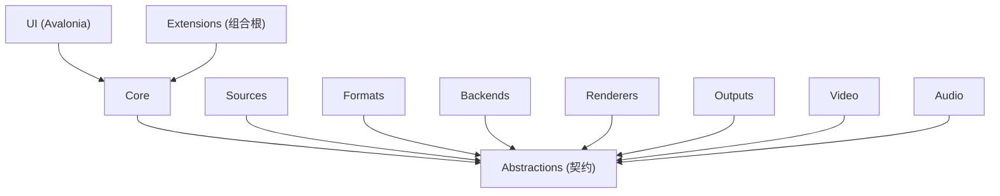
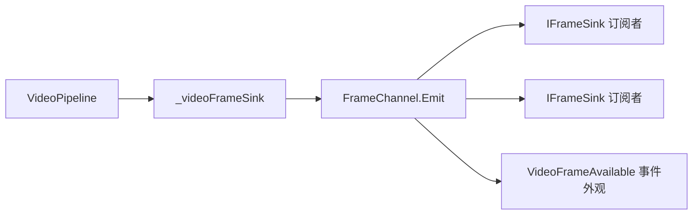

# 架构总览

LingFan.Media 是一个分层、契约驱动的系统。契约层是其余各层共同依赖的「法律」；核心编排播放，不感知任何具体后端或 UI；后端、渲染器与输出经依赖注入接入。

## 模块图

| 模块 | 职责 |
|---|---|
| Abstractions | 纯契约：接口、模型、枚举、事件。零实现，零外部引用。 |
| Core | 播放编排：时钟、缓冲、帧路由、管线宿主、会话生命周期。不感知后端或 UI。 |
| Sources | 媒体来源：文件、网络（HTTP/HTTPS）、包装流；流工厂与 SSRF 防护。 |
| Formats | 容器解析与解封装辅助、格式探测。 |
| Video | 视频轨道模型、处理链与配置。 |
| Audio | 音频轨道模型、混音、音效与配置。 |
| Backends | 可插拔解码/解封装：FFmpeg、LibVLC、Media Foundation、MediaCodec、AVFoundation。 |
| Renderers | GPU 视频输出：D3D11、Vulkan、OpenGL、OpenGL ES、Metal。 |
| Outputs | 音频输出：WASAPI、OpenAL、OpenSL ES、AAudio、AVAudioEngine。 |
| Platforms | 平台服务与原生互操作辅助。 |
| Extensions | DI 组合根：`AddLingFanMedia()` 与各模块注册扩展。 |
| UI（Avalonia） | 可选呈现层：`VideoView`、呈现器、控件。依赖 Core，绝不反向。 |

## 依赖方向

依赖单向指向契约：

- `Abstractions` 除 BCL 与日志抽象外不引用任何东西。
- `Core` 只引用 `Abstractions`——绝不引用后端、渲染器或 UI 框架。
- 后端、渲染器、输出引用 `Abstractions`（及 GPU 胶水层），彼此不互相引用，也不引用 UI。
- 被两个以上层引用的类型住在 `Abstractions`；仅单模块使用的类型留在该模块内。

## 帧路由

视频帧经唯一通道流动。无头消费者与 UI 消费者之间不存在第二条分歧投递路径。

- `IFrameChannel` 是端口：`Subscribe(IFrameSink)`、`Unsubscribe(IFrameSink)`、`Emit(VideoFrame)`。`IFrameSink.OnFrame(VideoFrame)` 收到的是**只读借用**——sink 不得释放该帧，也不得在调用返回后持有引用（多播订阅下这样做会导致释放后使用）。
- 公共的 `IMediaPlayer.VideoFrameAvailable` 事件是该通道之上的 `Action<VideoFrame>` 适配器。高级消费者（录制、缩略图、推理）可直接实现 `IFrameSink` 并订阅。
- 无头消费者辅助类（`ProcessingFrameSink`、`ProcessingAudioSink`）实现 `IHeadlessFrameConsumer` / `IHeadlessAudioConsumer` 并接入管线；UI 的 `VideoView` 订阅通道并呈现帧。

## 统一端口（及一处有意的非对称）

- **视频**经 `IFrameChannel` / `IFrameSink` 路由，任意数量的消费者可观察同一批解码帧。
- **音频**直接提交到 `IAudioOutput.Submit`，绕过视频同步器。这一非对称是有意的：音频是计时主时钟，按自身时钟推送到设备，而视频相对该时钟节流。

## 无头优先

`IVideoRenderer.Present` 由无头消费者使用的同一帧通道驱动。在 UI 中，`VideoView` 订阅通道并经平台合成器呈现（DirectComposition、CAMetalLayer、SurfaceFlinger、Wayland 子表面）。核心绝不自行创建原生窗口——渲染总是合成进宿主表面，因此 UI 控件可自由覆盖视频。

## 会话隔离与 DI 生命周期

- 系统级工厂（流工厂、解码/渲染/输出工厂、编解码注册表）是**单例**，在组合根注册一次。
- 每个 `IMediaPlayer` 拥有独立**会话**（`IMediaSession`）：自己的 `IMediaClock`、`IBufferManager` 与管线。会话对象在 `OpenAsync` 内创建，而非构造函数中，因此播放器可廉价构造、稍后打开。
- 这使并发播放器完全隔离——会话之间不共享时钟、缓冲或管线状态。
