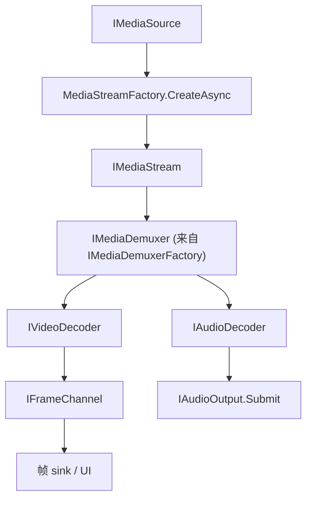
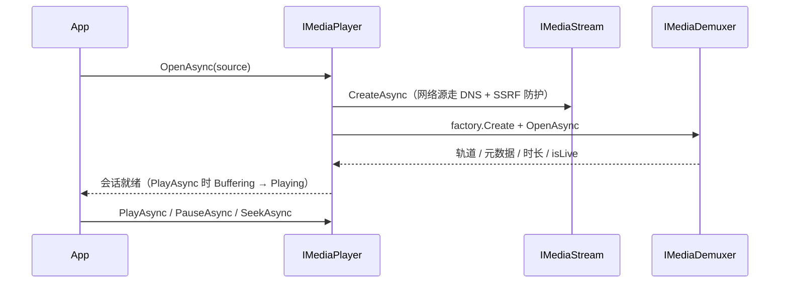

# 解码后端

后端在共享契约后提供解封装与解码。后端可互换：注册不同后端只改一行 DI，核心、渲染器与输出不受影响。逐平台的权威可用性矩阵见[平台支持](/zh/guide/platforms)。

## 后端架构

解封装工厂以有序集合注册（经各后端的 `AddXxx()`），因此播放器可按序尝试并回退。若没有已注册后端能打开某源，`Create`/`Open` 会抛出 `MediaBackendUnsupportedException`，而非悄悄失败。

## 跨平台后端

| 后端 | 许可 | 角色 | 平台 |
|---|---|---|---|
| FFmpeg | LGPL 2.1+（共享构建） | 主解码/解封装 | Windows、Linux、Android、macOS、iOS |
| LibVLC | LGPL 2.1+ | 回退引擎 | Windows、Linux（其他平台视支持情况） |

两者均在运行时动态加载，都不静态链接。合规模型见[许可](/zh/guide/licensing)。

## 各后端的 GPU 零拷贝

| 后端 | 零拷贝 | 路径 |
|---|---|---|
| FFmpeg | 是 | Windows：D3D11VA / DXVA2 → D3D11（及 Vulkan/OpenGL 导入）。Linux：VAAPI → dma-buf → Vulkan（驱动导入面受限时 OpenGL 回落 CPU 上传）。 |
| MediaCodec | 是 | Android：Surface 输出 → AHardwareBuffer → GLES/EGL 桥接 → 同设备 Skia GPU 采样；保留 ByteBuffer CPU 路径作跨厂商回落。 |
| Media Foundation | 否 | MFT 管线在此路径不暴露可导入的共享纹理；帧经 CPU 内存交回（管线固有属性，非缺陷）。 |
| LibVLC | 否 | 3.x 回调 API 交付 CPU 像素，故此路径用 CPU 拷贝。真零拷贝需 libvlc 4.0，尚未采用。 |

此处「零拷贝」指解码帧从解码器到渲染器始终保持 GPU 资源（`IFrameResource`）形态，无 CPU 往返。当平台或驱动无法导入该表面时，渲染器回落到正确的 CPU 上传——画面仍正确，只是拷贝路径不同。

## 平台原生后端

| 平台 | 原生后端 | 状态 |
|---|---|---|
| Windows | Media Foundation | 可用 |
| Android | MediaCodec | 可用（真机已验证） |
| Apple（macOS / iOS） | AVFoundation | 部分；尚未完整验证 |
| Linux | 无原生 | 使用 FFmpeg 配 VAAPI 硬解 |

## 未实现

| 后端 | 状态 |
|---|---|
| GStreamer | 空脚手架；无实现。不在路线内。 |
| WebRTC | 抛 `PlatformNotSupportedException` 的桩。不在路线内。 |

## 从打开到就绪

`OpenAsync` 执行真实 I/O（创建流、打开解封装器、初始缓冲）。`PlayAsync` / `PauseAsync` 是内存态切换。`SeekAsync` 经流重新定位（网络源以 Range 重开连接）。
