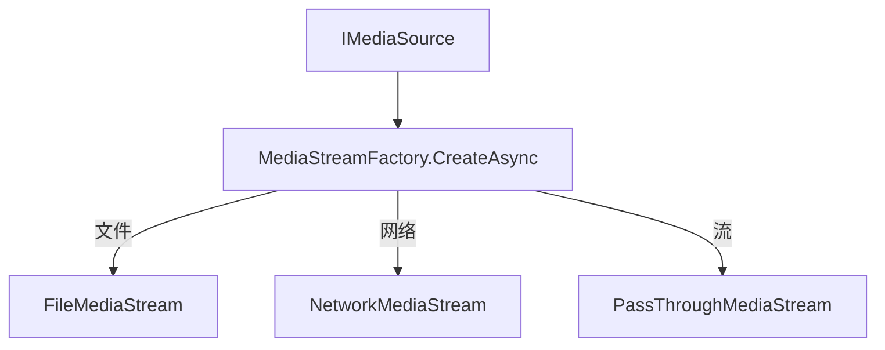

# 媒体源

媒体源描述媒体从何而来。流工厂把源变成解封装器可读取的 `IMediaStream`。支持三种源。

## 源类型

| 源 | 种类 | 产出的流 | 说明 |
|---|---|---|---|
| `FileMediaSource` | 文件 | `FileMediaStream` | 本地文件；文件播放的主路径。 |
| `NetworkMediaSource` | 网络（HTTP/HTTPS） | `NetworkMediaStream` | 带 SSRF 防护；支持基于 Range 的定位、自定义头、Cookie 与读超时。 |
| `StreamMediaSource` | 流 | `PassThroughMediaStream` | 包装调用方提供的 `System.IO.Stream`。 |

工厂按 `IMediaSource.Type`（`MediaSourceType`）模式匹配，构造对应的流。

## 实现要点

- **网络 SSRF 防护。** `NetworkMediaSource` 拒绝 `file://` 等非 HTTP(S)  scheme，默认拒绝私有 / 回环 / 链路本地地址。DNS 在防护检查前解析，解析出的 IP 被钉住用于连接，关闭了重定向可能借以触达内网地址的再解析窗口。
- **基于 Range 的定位。** 网络定位以 HTTP `Range` 请求重开连接，而非 seek 套接字。忽略 `Range` 的服务器（回 `200` 而非 `206`）会被识别并拒绝，因此不可定位的流绝不会被悄悄当作可定位。
- **打开头。** User-agent、自定义头与 Cookie 汇总在流契约上，供地址式后端透传。
- **流源。** `StreamMediaSource` 包装调用方拥有的流；该流的线程安全与生命周期由调用方负责。
- **直播标志。** `IsLive` 由源种类派生（网络源视为可能直播）；不可定位源的定位取决于底层流的能力。

打开的流如何交给解封装器见[解码后端](/zh/guide/backends)；`IMediaSource` / `IMediaStream` 的精确签名见 [API 参考](/zh/api/)。
