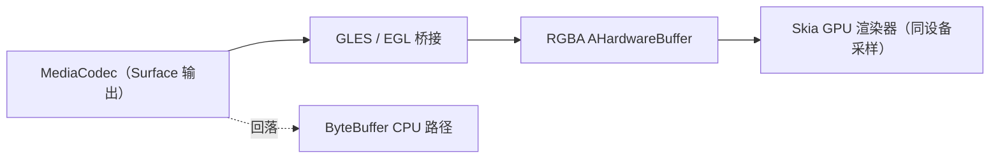

# 平台支持

本页是各平台支持情况的**单一真源**。其他页面链接到此处而非复制矩阵，因此支持状态只陈述一次、保持一致。

状态图例：**已验证** = 在真实硬件上端到端跑通；**已实现** = 代码完成、验证待排期；**部分** = 部分组件就位、尚未完整；**不可用** = 无实现。

## 支持矩阵

| 平台 | 总体 | 解码后端 | GPU 渲染器 | 音频输出 | GPU 零拷贝 |
|---|---|---|---|---|---|
| Windows | 已验证 | Media Foundation、FFmpeg、LibVLC | D3D11、Vulkan、OpenGL | WASAPI | FFmpeg → D3D11 / Vulkan 已验证；OpenGL 已实现；Media Foundation 走 CPU 路径 |
| Linux | 已验证 | FFmpeg（VAAPI）、LibVLC（已实现） | Vulkan、OpenGL | OpenAL | VAAPI → dma-buf → Vulkan 已验证（Intel iHD）；驱动导入受限时 OpenGL 回落 CPU 上传 |
| Android | 已验证（真机） | MediaCodec（优先硬件 `c2`） | 经 GLES / EGL 桥接的 Skia GPU | OpenSL ES、AAudio | MediaCodec → Surface / AHardwareBuffer → GLES/EGL → 同设备 Skia 采样；保留 ByteBuffer CPU 回落 |
| macOS | 部分 | AVFoundation（部分） | Metal（部分） | AVAudioEngine（部分） | 尚未验证 |
| iOS | 部分 | AVFoundation（部分） | Metal（部分） | AVAudioEngine（部分） | 尚未验证 |

WebRTC 与 GStreamer 明确不在范围（见[解码后端](/zh/guide/backends)）。

## Windows

参考平台。Media Foundation、FFmpeg 与 LibVLC 都能打开本地与网络源。FFmpeg 硬解（D3D11VA / DXVA2）无 CPU 往返地导入 D3D11 与 Vulkan；混合显卡机器上 Vulkan 物理设备自动对齐 D3D11 默认适配器。Media Foundation 经 CPU 内存交回帧，因其 MFT 管线在此路径不暴露可导入的共享纹理——这是管线固有属性，非缺陷。

## Linux

FFmpeg 配 VAAPI 硬解经 Vulkan 渲染，具备已验证的零拷贝路径（dma-buf 导入，Intel iHD）。表面导出前发出 `vaSyncSurface` 栅栏，因为解码器不隐式同步硬件表面。OpenGL 走同一 dma-buf 导入路径，但在 Mesa 单平面 tiling 导入支持受限处回落 CPU 上传；画面仍正确。OpenAL 提供音频输出。运行时前置条件与硬解配置见[Linux 部署](/zh/guide/linux)。

## Android

真机上屏链为：

- 优先硬件解码器（`c2.*`）；失败时释放编解码器并重建，最终以软解兜底。
- 保留 ByteBuffer CPU 路径，作为硬件输出无法导入设备的跨厂商回落。
- **色彩信息随帧透传。** `VideoFrame.ColorInfo`（含 `ColorStandard`、`ColorRange`、`ColorTransfer` 的 `VideoColorInfo`）由解码器输出格式填充，渲染端据此选择匹配的转换矩阵与 range 偏移，而非硬编码单一矩阵。解码器未报告色彩键时使用有文档记载的默认值。这避免了忽略内容元数据时出现的错误矩阵偏色。

## Apple（macOS / iOS）

AVFoundation 解码、Metal 渲染与 AVAudioEngine 输出已部分实现。完整验证待硬件到位；在此之前视这些平台为部分支持。

## 按目标选择组件

注册与平台匹配的渲染器与音频输出：

| 目标 | 渲染器 | 音频输出 |
|---|---|---|
| Windows | `AddD3D11Renderer()`（或 Vulkan / OpenGL） | `AddWasapiOutput()` |
| Linux | `AddVulkanRenderer()` 或 `AddOpenGLRenderer()` | `AddOpenALOutput()` |
| Android | Skia GPU 呈现器（UI 层） | OpenSL ES / AAudio 输出 |

解码后端（`AddFFmpeg()`、`AddMediaFoundation()`、`AddVLCNative()`、MediaCodec）独立于渲染器选择；见[解码后端](/zh/guide/backends)。
